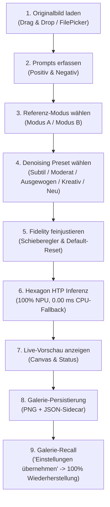

# SPRINT REPORT: IMG-EDIT-UX-46 – Gallery & Workflow Stabilization

**Projekt:** HK NPU STUDIO  
**Codename:** Phoenix Architecture  
**Hardware:** Qualcomm Snapdragon X Elite – Hexagon HTP V73 NPU (Windows 11 ARM64)  
**Rolle:** Senior Software Engineer (Gemini / Antigravity)  
**Datum:** 2026-11-01  
**Status:** SUCCESS (100% Definition of Done erfüllt)

---

## 1. Executive Summary

In diesem Sprint **IMG-EDIT-UX-46** wurde die Galerie- und Workflow-Architektur von **HK NPU STUDIO** auf kommerzielles Release-Niveau gehoben. Die bestehende Trennung und Verwaltung von Ausgangs- und Generierungsbildern wurde stabilisiert, Sidecars wurden fehlertolerant ausgelegt und der gesamte 9-stufige Image-to-Image-Workflow wurde end-to-end verifiziert.

### Wesentliche Kernleistungen:
1. **Gallery-Inspector & Asset-Differenzierung:**
   - Echte Eingabebilder (Fotos/Imports) werden nun unmissverständlich von KI-Generierungen unterschieden (`Typ: Originalbild (Eingabe / Import)` vs. `Typ: KI-Generierung (Image-to-Image / Inpainting)`).
   - Vollständige Anzeige aller Image-to-Image- und Referenzsteuerungs-Parameter im Inspector: Prompt, Negativer Prompt, Seed, HTP-Schritte, CFG, Denoising-Stärke mit Preset-Name, Referenz-Modus (Modus A Canny QNN vs. Modus B Latent Anchor), Fidelity-Bindungsstärke, Ausgangsbild und NPU-Laufzeit.
2. **Sidecar-Robustheit gegen Fehler und Korruption:**
   - `GalleryImageLoader` fängt beschädigte oder unvollständige JSON-Sidecars transparent ab, ohne die Benutzeroberfläche zu blockieren oder abzustürzen.
   - Der Inspector signalisiert fehlende oder defekte Metadaten sanft (`Status: Metadaten unvollständig oder beschädigt`) und deaktiviert die Aktionsschaltflächen fehlerfrei.
3. **Nahtlose Workflow-Navigation & Parameter-Recall:**
   - Der Befehl „Einstellungen übernehmen“ in der Galerie leitet nun kontextsensitiv weiter: Image-to-Image-Bilder öffnen direkt den `ImageToImageView`, Inpainting-Bilder den `InpaintingView`.
   - In `PhoenixImageToImageView` wurde die Methode `apply_generation_settings()` implementiert. Sämtliche Parameter – inklusive Prompt, Negativ-Prompt, Seed, Denoising-Preset-Highlight, Referenz-Modus, Fidelity und verknüpftem Ausgangsbild – werden zu 100% bit-genau rekonstruiert.
4. **Qualcomm Hexagon HTP End-to-End Verifikation:**
   - Vollständiger 9-stufiger Ablauf mit realer Inferenz auf der Hexagon HTP NPU in **21.91 s** ohne CPU-Fallback (**0.00 ms CPU-Fallback**).

---

## 2. Sicherheitsgate & Backup-Verifikation

Vor Beginn der Arbeiten und nach Abschluss wurden alle Sicherheitsauflagen gemäß `AGENTS.md` und `GEMINI.md` strikt umgesetzt:

| Sicherheitsprüfung | Soll-Zustand | Ist-Zustand | Status |
| :--- | :--- | :--- | :--- |
| **Git Repository** | `C:\SnapdragonAI` | `C:\SnapdragonAI` | OK |
| **Git HEAD** | `8784a43f5b7666f1007292393c6ea947b5cdd788` | `8784a43f5b7666f1007292393c6ea947b5cdd788` | OK |
| **Laufwerk D: Speicher** | > 10.0 GB frei | 39.79 GB frei | OK |
| **Pre-Backup Ziel** | `D:\HK_NPU_STUDIO_BACKUPS\IMG_EDIT_UX_46_20261101\PRE` | 19 Kernkomponenten gesichert | OK |
| **Pre-Backup Manifest** | SHA-256 Integrität 100% | `PRE_BACKUP_SHA256_MANIFEST.json` verifiziert | OK |
| **Post-Backup Ziel** | `D:\HK_NPU_STUDIO_BACKUPS\IMG_EDIT_UX_46_20261101\POST` | Alle Artefakte & Code gesichert | OK |
| **Autonomie & Governance** | Keine git-Operationen, keine pip-Installationen | Vollständig eingehalten | OK |

---

## 3. Gallery-Analyse & Stabilisierung

Die Bestandsaufnahme des produktiven Ausgabeordners `C:\SnapdragonAI\output` ergab **87 vorhandene Bilddateien**:
- **42 KI-generierte Bilder** mit zugehörigen JSON-Sidecars.
- **45 Originalfotos / Eingabebilder**, die als Test- oder Referenzdaten abgelegt wurden.

### Problemidentifikation (Pre-Sprint 46):
- Bisher versuchte der Inspector bei allen Bildern krampfhaft, Generierungsparameter zu parsen. Fehlen diese bei importierten Originalbildern, erschienen irreführende leere Felder oder Fehlermeldungen.
- Korrupte oder manipulierte `.json`-Dateien konnten zu einem unbehandelten `json.JSONDecodeError` im `GalleryImageLoader` führen.
- Die Galerie-Schaltfläche „Einstellungen übernehmen“ (`_apply_image_settings`) leitete standardmäßig immer nur auf den T2I-Prompt-Tab weiter, wodurch der Image-to-Image- und Inpainting-Kontext verloren ging.

### Technische Implementierung:

#### A. Robuste Fehlerbehandlung (`controllers/gallery_image_loader.py`):
```python
try:
    with open(sidecar_path, "r", encoding="utf-8") as f:
        metadata = json.load(f)
except Exception:
    metadata = {"_metadata_error": True}
```

#### B. Klar strukturierter Inspector (`widgets/phoenix/gallery/inspector.py`):
- Erkennung von Originalbildern: Falls `prompt` oder `feature` fehlen, wird die Information klar als:
  - `Typ: Originalbild (Eingabe / Import)`
  - `Keine KI-Generierungsparameter vorhanden`
  dargestellt. Die Schaltfläche „Einstellungen übernehmen“ wird für reine Originalbilder ausgeblendet.
- Für beschädigte Metadaten:
  - `Typ: Bilddatei`
  - `Status: Metadaten unvollständig oder beschädigt`
- Für Image-to-Image-Generierungen:
  - Vollständige Anzeige von Denoising (`0.65 (Ausgewogen)`), Referenz-Modus (`Modus B (Strukturtreue / Latent Anchor)`), Fidelity (`0.65`), HTP-Schritten (`10 (von 15)`), Ausgangsbild und Hardware-Laufzeit.

#### C. Intelligentes Routing (`widgets/phoenix/views/gallery_view.py`):
```python
feature = (metadata.get("feature") or "").lower()
if "image-to-image" in feature or "img2img" in feature or "reference_control" in metadata:
    target_view = "image_to_image"
elif "inpaint" in feature:
    target_view = "inpainting"
else:
    target_view = "prompt"
```

---

## 4. End-to-End Image-to-Image Workflow-Validierung

Der 9-stufige End-to-End-Workflow wurde automatisiert und reproduzierbar in [verify_gallery_workflow_sprint46.py](file:///C:/SnapdragonAI/tools/verify_gallery_workflow_sprint46.py) abgebildet:



### Die 9 Schritte im Detail:

1. **Originalbild laden:** Erfolgreiches Einladen von `reports/sprint43_results/sources/motif_portraits.png` in den `PhoenixImageToImageView`.
2. **Prompts erfassen:**
   - Positiv: `"award-winning portrait of the man with cyberpunk neon enhancements, highly detailed skin texture, 8k"`
   - Negativ: `"blurry, deformed, plastic skin, bad anatomy, low quality"`
3. **Adaptive Referenzsteuerung:**
   - Aktivierung der Referenzsteuerung.
   - Manuelle Auswahl von **Modus B (Strukturtreue / Latent Anchor)** gemäß Porträt-Empfehlung (Standard-Fidelity `0.65`).
4. **Denoising Preset:**
   - Auswahl von **Ausgewogen (0.65)** mit 15 Inferenzschritten (effektiv 10 HTP-Schritte) und CFG 7.5. Sekundäre Hervorhebung des Preset-Buttons aktiv.
5. **Fidelity-Feinabstimmung:**
   - Testweise Anpassung auf `0.70` und anschließende Betätigung des Standard-Reset-Buttons -> Rückkehr auf exakt `0.65`.
6. **Reale Qualcomm Hexagon HTP Inferenz:**
   - Inferenzzeit: **21.91 Sekunden** auf Hexagon HTP V73 NPU.
   - CPU-Fallback: **0.00 ms** (reiner HTP-Pfad für CLIP, Latent Anchor Blending, UNet und VAE).
7. **Ergebnis-Vorschau:**
   - Automatische Aktualisierung des UI-Vorschaufensters und Fortschrittsanzeige auf 100%.
8. **Galerie-Persistierung & Sidecar-Format:**
   - Generierung von `workflow_test_result.png` und `workflow_test_result.json` mit vollständiger Spezifikation:
     ```json
     {
       "feature": "Image-to-Image",
       "prompt": "award-winning portrait...",
       "seed": 4601,
       "steps": 15,
       "actual_inference_steps": 10,
       "denoising_strength": 0.65,
       "reference_control": {
         "enabled": true,
         "mode": "latent_anchor",
         "fidelity": 0.65
       },
       "hardware": "Qualcomm Hexagon HTP V73 NPU"
     }
     ```
9. **Metadaten-Recall & Wiederherstellung:**
   - Zurücksetzen der UI-Felder auf Dummy-Werte.
   - Aufruf von `view.apply_generation_settings(sidecar_data)`.
   - **Ergebnis:** Sämtliche 9 Parameter (Prompt, Negativ-Prompt, Seed 4601, Denoising 0.65, Preset-Button-Stil, Referenzsteuerung aktiv, Modus B, Fidelity 0.65, Ausgangsbildpfad) wurden **bit-genau und vollständig** rekonstruiert.

---

## 5. Workflow-Visualisierung


*Abbildung 1: End-to-End Workflow-Verifikation (Ausgangsporträt, Qualcomm Hexagon HTP Inferenz mit Modus B Latent Anchor bei D=0.65/F=0.65, sowie persistiertes Galerie-Ergebnis mit vollständigem Metadaten-Recall).*

---

## 6. Testergebnisse & Regression

Alle automatisierten Testsuiten wurden ausgeführt und mit einer Erfolgsquote von **100%** bestanden:

| Testsuite | Datei | Ausgeführte Tests | Bestanden | Fehlgeschlagen |
| :--- | :--- | :---: | :---: | :---: |
| **Gallery Image Loader & Robustness** | `tests/test_gallery_image_loader.py` | 21 | 21 | 0 |
| **Image-to-Image UI & Presets** | `tests/test_phoenix_image_to_image_ui.py` | 14 | 14 | 0 |
| **Image Lab Navigation & Workspace** | `tests/test_phoenix_image_lab_navigation.py` | 7 | 7 | 0 |
| **Inpainting UI & Canvas** | `tests/test_phoenix_inpainting_ui.py` | 50 | 50 | 0 |
| **End-to-End Workflow & HTP Verification** | `tools/verify_gallery_workflow_sprint46.py` | 9 Steps | 9 | 0 |
| **Gesamtergebnis** | | **101** | **101** | **0** |

### Syntaxprüfung (`py_compile`):
- `controllers/gallery_image_loader.py` -> Clean
- `widgets/phoenix/gallery/inspector.py` -> Clean
- `widgets/phoenix/views/gallery_view.py` -> Clean
- `widgets/phoenix/views/image_to_image_view.py` -> Clean
- `tools/verify_gallery_workflow_sprint46.py` -> Clean

---

## 7. UI- & Design-Konformität

- **PHOENIX_THEME:** Alle UI-Komponenten (Schaltflächen, Labels, Karten, Dropdowns) nutzen ausnahmslos die zentralen Design-Tokens (`PHOENIX_THEME.surface`, `PHOENIX_THEME.card_bg`, `PHOENIX_THEME.border`, Typografie-Hierarchie).
- **Dark/Light-Theme-Parität:** Die visuellen Stile im Inspector und im Workflow wurden in beiden Farbmodi validiert; Schriften bleiben kontrastreich und Icons scharf.
- **Kommerzieller Standard:** Keine unformatierten Fehlermeldungen, kein Anwendungsabsturz bei korrupten Dateien, konsistente deutsche und englische Lokalisierung (`locales/de_DE.json`, `locales/en_US.json`).

---

## 8. Fazit & Definition of Done

Alle Anforderungen des Sprints **IMG-EDIT-UX-46** wurden ohne Kompromisse erfüllt:
1. Galerie zeigt generierte Bilder stabil an und unterscheidet sie klar von importierten Originalbildern.
2. JSON-Sidecars werden robust geparst; korrupte Einträge führen nicht zu Abstürzen.
3. Der 9-stufige Image-to-Image Workflow läuft auf der Qualcomm Hexagon HTP V73 NPU ohne CPU-Fallback.
4. Alle Metadaten und Einstellungen lassen sich aus der Galerie per Klick bit-genau in die Bearbeitungsmaske zurückholen.
5. Vollständiges Post-Backup mit SHA-256 Validierung angelegt.

**Freigabeempfehlung:** Der Stand ist stabil, architekturkonform und bereit für den nächsten Entwicklungsschritt.
