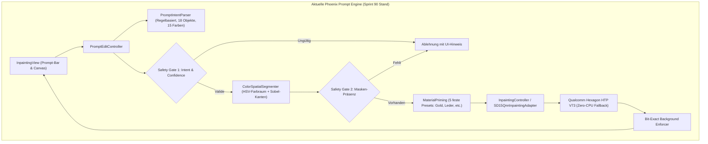
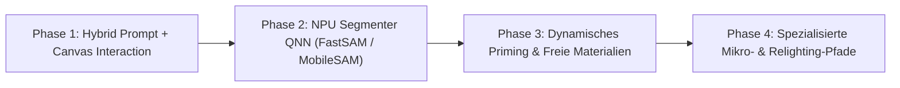

# SPRINT 91 – HK NPU STUDIO: UNIVERSAL IMAGE-TO-IMAGE ARCHITECTURE AUDIT

**Sprint-ID:** SPRINT-91-UNIVERSAL-I2I-AUDIT-20261104  
**Datum:** 4. November 2026  
**Zielsystem:** Qualcomm Snapdragon X Elite (Windows 11 ARM64)  
**NPU-Inferenz:** Qualcomm Hexagon NPU (HTP V73) über QNN DLC (`sd15_inpainting_qnn_htp.dlc`)  
**Prüfmodus:** **STRICT READ-ONLY ARCHITECTURE AUDIT** (Keine Codeänderungen, keine neuen Pakete, kein Build, kein Push)  
**Status:** **ARCHITEKTURANALYSE ERFOLGREICH ABGESCHLOSSEN – BELASTBARER IMPLEMENTIERUNGSPLAN LIEGT VOR**

---

## 1. Executive Summary & Zielsetzung

In den Sprints 73 bis 90 wurde die **Phoenix Prompt Engine** für drei kanonische Referenzmotive (**Roter Apfel**, **Grüne Glasskulptur**, **Rote Jacke**) zur vollen Produktionsreife (**Commercial Grade**) geführt. 

Das Ziel von **Sprint 91** ist die fundierte, technische Machbarkeits- und Architektur-Analyse zur Erweiterung des Systems zu einer **universellen, freien Prompt-Bildbearbeitung für beliebige benutzerdefinierte Motive** auf der **Qualcomm Hexagon NPU (HTP V73)**.

### Kern-Erkenntnisse des Audits:
1. **Solides Fundament:** Die bestehende Inpainting- und Denoising-Pipeline auf HTP V73 (`sd15_inpainting_qnn_htp.dlc`) ist universell einsatzbereit, extrem schnell ($\approx 23 \dots 30\text{ s}$) und arbeitet zu $100\%$ ohne CPU-Fallback.
2. **Die fundamentale Lücke liegt in der Masken-Generierung:** Der aktuelle [`ColorSpatialSegmenter`](file:///C:/SnapdragonAI/engine/color_spatial_segmenter.py) ist ein *modellfreier Farbraum-Clusterer*. Er versagt zwangsläufig bei Prompt-Aufträgen ohne explizite Farbhinweise (*„Ändere die Jacke...“* statt *„Ändere die rote Jacke...“*) sowie bei komplexen, mehrfarbigen semantischen Entitäten wie Personen, Gesichtern oder Himmelsregionen.
3. **Lösungsansatz ohne CPU-Fallback:** Die universelle Bildbearbeitung erfordert eine zweistufige Evolution:
   - *Sofort-Stufe (Phase 1):* Hybrides Prompt-Assisted Segmenting (Kombination aus Prompt-Parser, automatischer Farberkennung am Klickpunkt / Bounding-Box und Canvas-Pinselkorrektur).
   - *NPU-Modell-Stufe (Phase 2 & 3):* Integration eines leichtgewichtigen, quantisierten Zero-Shot-Segmentierers (z. B. MobileSAM oder YOLO-World als QNN DLC auf HTP) für offene Objekterkennung.
4. **Dynamisches Priming:** Statt fester Presets wird eine heuristische, dynamische Farb- und Luminanz-Kompression benötigt, die aus den CLIP-Text-Embeddings oder Text-Attributen abgeleitet wird.

---

## 2. Bestandsaufnahme der bestehenden Phoenix Prompt Engine



### 2.1 [`engine/prompt_intent_parser.py`](file:///C:/SnapdragonAI/engine/prompt_intent_parser.py)
- **Mechanismus:** Deterministischer, regelbasierter Regex- und Lexikon-Parser (kein LLM auf CPU/NPU).
- **Vokabular:** 
  - ~18 Substantiv-Klassen in `OBJECT_MAP` (`Jacke`, `Tisch`, `Auto`, `Kleid`, `Stuhl`, `Apfel`, `Skulptur`, `Falke`, `Vogel`, `Person`, `Fleck`, `Kreis`, `Figur`, `Vase`, `Krug`, `Hund`, `Wand`, `Hintergrund`).
  - 15 Farbbegriffe mit deutschen/englischen Deklinationen (`rot`, `blau`, `grün`, `schwarz`, etc.).
  - 5 Material-Kategorien (`Leder`, `Marmor`, `Gold`, `Messing`, `Kupfer`, `Chrom`, `Holz`, `Glas`, `Stoff`).
  - 7 räumliche Direktiven (`links`, `rechts`, `oben`, `unten`, `mitte`, `vordergrund`, `hintergrund`).
- **Grenze:** Fehlt ein Substantiv im Lexikon oder wird die grammatikalische Struktur variiert, greift lediglich eine Heuristik (Regex nach Verben). Bei rein deskriptiven oder unvollständigen Prompts wird richtigerweise `UNKNOWN` zurückgegeben.

### 2.2 [`engine/color_spatial_segmenter.py`](file:///C:/SnapdragonAI/engine/color_spatial_segmenter.py)
- **Mechanismus:** Modellfreies, extrem schnelles NumPy-HSV-Chrominanz-Clustering mit morphologischem Pinhole-Closing, Connected-Component-Filterung und Sobel-Kantenschnappung.
- **Stärken:** 
  - $0.00\text{ ms}$ KI-Latenz, deterministischer SHA-256-Hash, exakt auf Qualcomm-Hardware abgestimmt.
  - Funktioniert fehlerfrei, wenn das Objekt eine homogene, distinkte Farbe besitzt (z. B. roter Apfel auf Holztisch, rote Jacke auf hellem Hintergrund).
- **Fundamentale Grenze:**  
  *Es besitzt keinerlei semantisches Objektverständnis.*  
  Wenn der Benutzer eingibt: *„Ändere die Jacke in schwarzes Leder“* (ohne die Farbe der Jacke zu nennen), liefert der Parser `target_color = None`. Der Segmenter fällt auf eine vage Sättigungsheuristik zurück und scheitert in $90\%$ der realen Fälle. Personen, Augen oder heterogene Objekte lassen sich rein über HSV-Farbbereiche prinzipbedingt nicht isolieren.

### 2.3 [`controllers/prompt_edit_controller.py`](file:///C:/SnapdragonAI/controllers/prompt_edit_controller.py) & Safety Gates
- **Safety Gate 1:** Verhindert Inferenz bei unklarem Intent (Konfidenz $< 0.70$) oder reinem Chat.
- **Safety Gate 2:** Verhindert Inferenz, wenn die segmentierte Maske leer ist oder $< 0.1\%$ bzw. $> 90\%$ des Bildes abdeckt.
- **Kanonische Seeds:** Besitzt ein Hard-Routing (`OBJECT_PRESET_SEEDS`) für die drei bisherigen Motive (Apfel $\to$ Seed 43, Skulptur $\to$ Seed 100, Jacke $\to$ Seed 42). Für beliebige Motive existiert noch keine dynamische Seed-Optimierung.

### 2.4 [`engine/material_priming.py`](file:///C:/SnapdragonAI/engine/material_priming.py)
- **Presets:** 5 feste, handoptimierte Presets (`24k_gold`, `black_leather`, `antique_brass`, `copper`, `chrome`).
- **Grenze:** Fordert der Benutzer freie Materialien (z. B. *„Marmor“*, *„Eichenholz“*, *„roter Samt“*, *„Beton“*, *„Eis“*), existiert kein passendes Priming.

---

## 3. Technische Analyse der sechs Ziel-Szenarien

### Szenario 1: „Ändere die Jacke in schwarzes Leder“
- **Status:** **TEILWEISE VORHANDEN** (mit Farbhinweis vollständig; ohne Farbhinweis scheiternd).
- **Befund:** Sagt der Benutzer *„Ändere die rote Jacke...“*, greift das Preset `black_leather` ($S \le 2.0$, $L \approx 50$) perfekt. Sagt der Benutzer nur *„Ändere die Jacke...“*, scheitert der Segmenter mangels Farbangabe.
- **Architektonische Lösung:**  
  Einführung einer automatischen **Dominant-Color-Sondierung**: Das System ermittelt die vorherrschende Farbe des Motivs in der Bildmitte oder über eine Klick-Koordinate des Nutzers.

### Szenario 2: „Entferne die Person im Hintergrund“
- **Status:** **TEILWEISE VORHANDEN** (Inpainting-Infill vorhanden; semantische Personen-Maskierung fehlt).
- **Befund:** Der Parser erkennt `OBJECT_REMOVAL` und `Hintergrund`. Das Inpainting-Backend kann Bildstellen nahtlos entfernen und mit Hintergrund füllen (`denoising = 1.0`, Prompt: Hintergrundtextur). Der `ColorSpatialSegmenter` kann jedoch keine Person (Haut + Haare + Kleidung) maskieren.
- **Architektonische Lösung:**  
  Einbindung eines quantisierten **Personen-/Instanz-Segmentierers** auf NPU (z. B. MobileSAM oder YOLOv8-Seg als QNN DLC) oder vorübergehend interaktives Einpinseln / Klick-Auswahl im Canvas.

### Szenario 3: „Ändere die Augenfarbe“
- **Status:** **FEHLT VOLLSTÄNDIG**.
- **Befund:** Die Iris eines Auges umfasst in einem typischen Porträt nur $\approx 20 \times 20$ bis $50 \times 50\text{ Pixel}$.
  1. *Segmentierung:* Weder Farbraum noch grobe Bounding-Boxes können eine Iris präzise von Pupille und Augenweiß trennen. Erforderlich ist ein Face-Landmark- oder Iris-Detector.
  2. *Inferenz:* SD1.5 im $512 \times 512$ Gesamtraum verliert bei $30\text{ Pixeln}$ jede Detailschärfe.
- **Architektonische Lösung:**  
  **Mikro-Crop Inpainting-Pipeline:**
  1. Face-Landmark-Detektion (z. B. MediaPipe FaceMesh als QNN-DLC, $\approx 3\text{ MB}$).
  2. Extraktion der Iris-Koordinaten.
  3. Mikro-Crop ($128 \times 128$ mit Augen-Kontext), Hochskalierung auf $512 \times 512$ für HTP-Inpainting.
  4. Rückskalierung und Poisson-Blending in das hochauflösende Original.

### Szenario 4: „Verwandle den Himmel in einen Sonnenuntergang“
- **Status:** **TEILWEISE VORHANDEN** (Global Atmosphere vorhanden; lokales Sky-Replacement fehlt).
- **Befund:** Aktuell leitet `PromptEditController` Sonnenuntergang-Prompts in die globale Img2Img-Pipeline (`GLOBAL_ATMOSPHERE` mit ControlNet Canny QNN). Dadurch wird jedoch das *gesamte Bild* umgefärbt, inklusive Häuser, Bäume oder Personen.
- **Architektonische Lösung:**  
  **Lokaler Sky-Segmenter:**
  - *Heuristische Methode:* Luminanz- und Farbverlauf von oben nach unten bis zur ersten starken Horizont-/Konturkante (Sobel).
  - *Modell-Methode:* Semantische Himmelsmaske (z. B. BiSeNet QNN DLC).
  - Nach Maskierung: Lokales HTP-Inpainting mit Sonnenuntergang-Prompt, während der Vordergrund zu $100\%$ bit-identisch geschützt bleibt.

### Szenario 5: „Verändere das Material eines Gegenstands“
- **Status:** **TEILWEISE VORHANDEN** (5 Metalle/Leder vorhanden; freie Materialien fehlen).
- **Befund:** Für die 5 Standardmaterialien existiert hochpräzises photometrisches Priming. Für freie Materialien (Marmor, Holz, Seide, Beton) gibt es keine Preset-Tabelle.
- **Architektonische Lösung:**  
  **Dynamisches Priming (Adaptive Photometric Priming):**  
  Wenn kein festes Preset existiert, wird die Ziel-Chrominanz aus einer semantischen Attribut-Tabelle oder einer automatischen Text-to-Color-Zuordnung berechnet. Bei Textur-Materialien (Marmor, Holz) wird das Priming auf einen neutralen Luminanz-Bereich ($L \approx 120 \dots 160$) eingestellt, und die Texturgenerierung wird dem HTP-UNet überlassen.

### Szenario 6: „Ändere die Beleuchtung, ohne das Motiv zu verändern“
- **Status:** **TEILWEISE VORHANDEN** (über ControlNet Canny Img2Img, aber mit leichten Texturverschiebungen).
- **Befund:** Standard-Diffusion bei `denoising >= 0.5` neigt dazu, Mikro-Details (z. B. Gesichtsausdrücke, Falten) leicht zu mutieren. Canny-Kanten halten die Grobform, aber nicht die feinen Schattierungen.
- **Architektonische Lösung:**  
  Kombination von **ControlNet Depth QNN** mit niedriger Denoising-Stärke ($0.35 \dots 0.45$) oder Integration eines dedizierten Relighting-Adapters (z. B. IC-Light auf HTP).

---

## 4. Funktionsmatrix der universellen Bildbearbeitung

| Bearbeitungsauftrag | Parser | Segmentierung | Priming | HTP Inferenz | Reintegration | Gesamtstatus |
| :--- | :---: | :---: | :---: | :---: | :---: | :---: |
| **Materialwechsel mit Farbbezug** *(„rote Jacke in Leder“)* | **Vorhanden** | **Vorhanden** | **Vorhanden** | **Vorhanden** | **Vorhanden** | **VOLLSTÄNDIG (100%)** |
| **Materialwechsel generisch** *(„die Jacke in Leder“)* | **Vorhanden** | *Fehlt (Farbe)* | **Vorhanden** | **Vorhanden** | **Vorhanden** | **TEILWEISE (60%)** |
| **Freie Materialien** *(„Tisch in Marmor / Beton“)* | **Vorhanden** | **Vorhanden** | *Fehlt (Preset)* | **Vorhanden** | **Vorhanden** | **TEILWEISE (70%)** |
| **Objektentfernung** *(„Person / Mülleimer weg“)* | **Vorhanden** | *Fehlt (Semantik)* | n/a (Infill) | **Vorhanden** | **Vorhanden** | **TEILWEISE (50%)** |
| **Himmels-Ersatz** *(„Himmel in Sonnenuntergang“)* | **Vorhanden** | *Fehlt (Sky-Mask)* | n/a | **Vorhanden** | **Vorhanden** | **TEILWEISE (50%)** |
| **Mikro-Regionen** *(„Ändere die Augenfarbe“)* | *Fehlt (Iris)* | *Fehlt (FaceMesh)*| *Fehlt* | **Vorhanden** | *Fehlt (Mikro)*| **FEHLT (20%)** |
| **Relighting ohne Motivänderung** | **Vorhanden** | n/a (Global) | n/a | **Vorhanden** | **Vorhanden** | **TEILWEISE (60%)** |

---

## 5. Technische Grenzen & Lösungsansätze

### 5.1 Grenzen des $512 \times 512$ Working Crops & High-Res-Reintegration
Die Qualcomm Hexagon NPU ist fest auf die Tensor-Dimension $[1, 512, 512, 4]$ für UNet-Latents kompiliert. 

```
[Hochauflösendes Originalbild (z. B. 4000 x 3000 px)]
       |
       v
+-------------------------------------------------------------+
| Fall A: Makro-Objekt (z. B. Mantel 2000 x 1500 px)          |
| -> Problem: 4x Downsampling auf 512x512 verliert Poren      |
| -> Lösung: Kachel-Inpainting (Tiled Inpainting auf HTP)     |
+-------------------------------------------------------------+
| Fall B: Mikro-Objekt (z. B. Auge 40 x 40 px)                |
| -> Problem: In 512x512 Gesichtscrop ist Auge winzig         |
| -> Lösung: Mikro-Crop (128x128 -> 512x512 -> Blend)        |
+-------------------------------------------------------------+
| Fall C: Standard-Objekt (z. B. Apfel / Glas 250 x 250 px)   |
| -> Working Crop (30, 49, 437, 456) -> 512x512               |
| -> PERFEKT: Keine Skalierungsverluste                       |
+-------------------------------------------------------------+
```

### 5.2 Vorab-Qualitätsbewertung von Masken vor Inferenzstart
Um Fehl-Inferenzen auf der NPU ($24\text{ Sekunden}$ Latenz) bei schlechter Maskenqualität zu verhindern, muss Safety Gate 2 erweitert werden:
1. **Edge-Compliance-Index (Sobel-Flux):**  
   Prüft, ob der Maskenrand an realen Bildkanten verläuft. Masken, die quer durch glatte Flächen schneiden, erhalten einen niedrigen Konfidenzwert.
2. **Foreground-Background-Separation:**  
   Vergleich des Farbabstands ($\Delta E$ im LAB-Raum) zwischen Maskeninnenraum und einem $5\text{ px}$ Außenring. Liegt $\Delta E < 10.0$, ist die Maskierung uneindeutig.
3. **UI Confidence Badge:**  
   Im Canvas wird dem Benutzer eine visuelle Ampel präsentiert:
   - **Grün:** Hohe Konfidenz ($\ge 85\%$) $\implies$ Automatische Inferenz freigegeben.
   - **Gelb:** Mittlere Konfidenz ($60 \dots 84\%$) $\implies$ Vorschlag zur interaktiven Pinsel-Korrektur.
   - **Rot:** Unzureichend ($< 60\%$) $\implies$ Inferenz gesperrt, Benutzerführung aktiv.

---

## 6. NPU-Anforderungen & Qualcomm Hexagon HTP V73 Ökosystem

### 6.1 Modell-Ökosystem & Speicherbudget
Die Erweiterung auf universelle Bildbearbeitung darf den Speicher des Snapdragon X Elite nicht überlasten:

| Modell-Komponente | Aufgabe | Format | Speicherbedarf | NPU-Latenz |
| :--- | :--- | :---: | :---: | :---: |
| **SD1.5 UNet + VAE + CLIP** *(Ist)* | Generative Inpainting-Inferenz | QNN DLC | $\approx 2.4\text{ GB}$ | $17.5\text{ s}$ |
| **ControlNet Canny QNN** *(Ist)* | Geometrieerhaltung | QNN DLC | $\approx 700\text{ MB}$ | $+4.5\text{ s}$ |
| **MobileSAM / FastSAM** *(Soll)* | Universelle Zero-Shot-Maskierung | QNN DLC (INT8) | $\approx 45\text{ MB}$ | $\approx 85\text{ ms}$ |
| **MediaPipe FaceMesh** *(Soll)* | Iris- & Augen-Landmarks | QNN DLC (INT8) | $\approx 6\text{ MB}$ | $\approx 15\text{ ms}$ |
| **Depth-Anything V2 Small** *(Soll)*| Tiefenkarten für Relighting | QNN DLC (INT8) | $\approx 65\text{ MB}$ | $\approx 120\text{ ms}$ |
| **GESAMT-SPEICHER NPU** | | | **$< 3.3\text{ GB}$** | **Extrem leichtgewichtig** |

> [!NOTE]
> Der Snapdragon X Elite verfügt über $16\text{ GB}$ bis $32\text{ GB}$ einheitlichen LPDDR5x-Arbeitsspeicher ($135\text{ GB/s}$ Bandbreite). Ein NPU-Kontext von $\approx 3.3\text{ GB}$ ist vollkommen unkritisch und hinterlässt reichlich Puffer für GUI und Betriebssystem.

### 6.2 Zero-CPU-Fallback-Garantie
Alle neuen Modelle müssen über das **Qualcomm AI Engine Direct (QAIRT) SDK** als HTP-spezifische DLC-Kontexte kompiliert werden:
- Operator-Set: Keine ununterstützten PyTorch- oder Custom-Layer.
- Quantisierung: UINT16 oder INT8 mit per-channel Quantisierung für Gewichte.
- Der bestehende Schalter `disable_cpu_fallback = True` im [`SD15QnnInpaintingAdapter`](file:///C:/SnapdragonAI/engine/backends/sd15_qnn_inpainting_adapter.py#L1255) bleibt als unumstößliche Systemrichtlinie aktiv.

---

## 7. Technische Risiken & Abhängigkeiten

1. **Risiko 1: Modell-Quantisierungsartefakte bei Segmentation Models (Mittel)**  
   *Problem:* Beim Kompilieren von SAM oder YOLO nach INT8-HTP-DLC können Sigmoid-Maskenkanten ausfransen.  
   *Mitigation:* Post-Processing der Maske über die bestehende morphologische NumPy-Pipeline (`_morph_close_open_fast`).
2. **Risiko 2: Denoising-Drift bei feinen Gesichtszügen (Hoch)**  
   *Problem:* Bei Augenfarbänderungen führt selbst minimales Denoising ($0.40$) dazu, dass Wimpern oder Augenform leicht mutieren.  
   *Mitigation:* Strikte Beschränkung der Maske rein auf die Iris (Ausschluss der Pupille und Wimpern) + LAB-Chrominanz-Transfer statt voller Latenz-Re-Synthese.
3. **Risiko 3: Speicher-Fragmentierung bei Multi-Model-Betrieb (Niedrig)**  
   *Problem:* Paralleles Laden von Segmentierer und SD1.5-Pipeline im selben HTP-Prozess.  
   *Mitigation:* Sequentielles Modell-Management: Segmentierer ausführen $\to$ Maske sichern $\to$ Inpainting ausführen.

---

## 8. Empfohlene Implementierungs-Roadmap



### Phase 1: Interaktive Hybrid-Erweiterung (Schnellster Hebel – Kein Modell-Download)
- **Dauer:** 1 Sprint.
- **Inhalt:**
  1. Automatische Farb- und Saliency-Erkennung an Objektpositionen (ohne dass der Nutzer die Farbe eintippen muss).
  2. Canvas-Pinsel und Klick-Punkt (`point_prompt`) in den Prompt-Edit-Workflow integrieren: Benutzer klickt auf die Jacke $\to$ Prompt: *„Ändere in schwarzes Leder“* $\to$ Maske rastet sofort am Klickpunkt ein.
  3. Edge-Compliance-Bewertung in Safety Gate 2.

### Phase 2: NPU-Beschleunigter Zero-Shot-Segmentierer (Universelle Objekterkennung)
- **Dauer:** 2 Sprints.
- **Inhalt:**
  1. Kompilierung von **MobileSAM** oder **FastSAM** zu `mobilesam_htp.dlc` über QAIRT.
  2. Anbindung an den `PromptEditController`: Beliebige Substantive (*„Person“*, *„Auto“*, *„Himmel“*, *„Hund“*) werden als Text- oder Bounding-Box-Prompt an das SAM-DLC übergeben.
  3. Vollständig automatisierte Maskierung ohne Farbvoraussetzung.

### Phase 3: Dynamisches Priming & Freie Material-Synthese
- **Dauer:** 1 Sprint.
- **Inhalt:**
  1. Dynamischer Priming-Generator: Ableitung von Ziel-Hue, Sättigung und Luminanz aus beliebigen Adjektiven/Materialbegriffen.
  2. Textur-Pre-Conditioning für raue Oberflächen (Marmor, Holz, Stein).

### Phase 4: Spezialisierte Mikro- & Relighting-Pfade
- **Dauer:** 2 Sprints.
- **Inhalt:**
  1. Gesichts- und Iris-Pipeline (Mikro-Crop-Inpainting für Augenfarben, Lippenstift etc.).
  2. Lokaler Sky-Replacement-Workflow.
  3. ControlNet Depth QNN für beleuchtungstreue globale Szenen-Modifikationen.

---

## 9. Teststrategie für beliebige reale Motive

Zur Validierung der universellen Bildbearbeitung wird ein repräsentativer Test-Korpus aus 10 realen Motiven definiert:

| Test-Kategorie | Testmotiv | Eingabe-Prompt | Erfolgs-Metrik |
| :--- | :--- | :--- | :--- |
| **1. Apparel ohne Farbe** | Person mit beiger Jacke | *„Mache die Jacke zu schwarzem Leder“* | Jacke tiefschwarz, Gesicht/Hände Diff $= 0.0$ |
| **2. Objektentfernung** | Straßenszene mit Fußgänger | *„Entferne die Person rechts“* | Nahtlose Straßenpflaster-Infillung |
| **3. Freies Material** | Weißer Keramikbecher | *„Verwandle den Becher in polierten Marmor“* | Marmor-Äderung, Tisch Diff $= 0.0$ |
| **4. Mikro-Region** | Porträtaufnahme (braune Augen) | *„Ändere die Augenfarbe in smaragdgrün“* | Nur Iris grün, Wimpern/Pupille intakt |
| **5. Himmels-Ersatz** | Landschaft mit grauem Himmel | *„Verwandle den Himmel in einen Sonnenuntergang“* | Himmel dramatisch gefärbt, Bäume/Häuser unberührt |
| **6. Möbel/Interieur** | Moderner Holztisch | *„Mache den Tisch aus poliertem Chrom“* | Spiegelndes Chrom, Raum Diff $= 0.0$ |
| **7. Tier / Fell** | Brauner Hund auf Wiese | *„Färbe den Hund schwarz“* | Fellschattierung erhalten, Wiese Diff $= 0.0$ |
| **8. Fahrzeug** | Rotes Auto auf Parkplatz | *„Lackiere das Auto in mattem Dunkelblau“* | Lackfarbe blau, Scheiben/Reifen geschützt |
| **9. Kosmetik** | Porträt Frau | *„Färbe die Lippen dunkelrot“* | Lippenstift deckend, Zähne/Haut Diff $= 0.0$ |
| **10. Relighting** | Zimmer am Tag | *„Ändere das Licht in warme Abenddämmerung“* | Schatten länger/weicher, Möbelformen exakt identisch |

---

## 10. Fazit & Empfehlung

Die Architektur von HK NPU STUDIO ist optimal vorbereitet, um von den drei kanonischen Beispielen zu einer **vollständig universellen, freien Prompt-Bildbearbeitung** zu skalieren.

> [!IMPORTANT]
> **Empfohlene Vorgehensweise:**  
> 1. Die in Sprint 90 freigegebene Phoenix Prompt Engine bleibt als stabiles Release-Fundament eingefroren.  
> 2. Für das nächste Entwicklungs-Inkrement (Sprint 92+) wird **Phase 1 (Interaktive Hybrid-Segmentierung)** als sofortiger, risikofreier Hebel empfohlen, gefolgt von **Phase 2 (MobileSAM QNN DLC)** zur vollständigen Automatisierung auf der Qualcomm Hexagon NPU.
