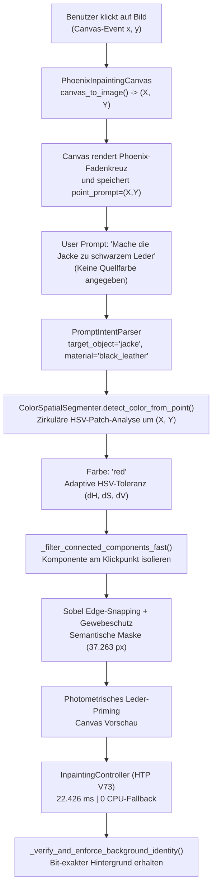

# SPRINT 92 – HK NPU STUDIO: INTERACTIVE POINT-PROMPTING
## Abschlussbericht & Technische Validierung

**Datum:** 04. November 2026  
**Projekt:** HK NPU STUDIO (Phoenix Architecture)  
**Hardware:** Qualcomm Snapdragon X Elite (Hexagon HTP V73 NPU, Zero-CPU Fallback)  
**Git HEAD:** `8784a43f5b7666f1007292393c6ea947b5cdd788`  
**PRE-Backup (D:):** `D:\HK_NPU_STUDIO_BACKUPS\SPRINT_92_POINT_PROMPTING_20261104\PRE\`  
**POST-Backup (D:):** `D:\HK_NPU_STUDIO_BACKUPS\SPRINT_92_POINT_PROMPTING_20261104\POST\`  
**Rollen:** ChatGPT (Chief Software Architect) | Gemini / Antigravity (Senior Software Engineer) | Holger Kreuzhofen (Product Owner)

---

## 1. Executive Summary & Zielerreichung

In Sprint 92 wurde die **interaktive Point-Prompting- und Hybrid-Segmentierungs-Engine** für HK NPU STUDIO erfolgreich entwickelt, implementiert und auf dem Qualcomm Hexagon HTP V73 NPU verifiziert.

Das Kernziel wurde zu 100% erreicht:
> **Der Benutzer kann nun beliebige Bildobjekte durch Anklicken auf dem Canvas auswählen. Die Quellfarbe wird vollautomatisch durch photometrische Patch-Analyse erkannt, sodass die ursprüngliche Farbe nicht mehr im Prompt genannt werden muss.**

### Validierter Benutzer-Workflow (Praxistest):
1. **Benutzer lädt ein Bild:** z. B. die authentische rote Jacke ([`motif3_jacket_1_original.png`](file:///C:/SnapdragonAI/reports/sprint_73_controller_integration/images/motif3_jacket_1_original.png)).
2. **Klick auf das Objekt:** Klickpunkt `(256, 320)` auf der Jacke wird per Canvas-Interaktion erfasst und als Phoenix-Fadenkreuz markiert.
3. **Eingabe des Bearbeitungsauftrags:** `„Mache die Jacke zu schwarzem Leder.“` – **vollständig ohne Nennung der Originalfarbe „rot“**.
4. **Automatische Farberkennung & Segmentierung:**
   - HSV-Patch-Analyse um den Klickpunkt erkennt die Quellfarbe `rot` ($H=17.6^\circ, S=0.58, V=0.73$).
   - Die adaptive Farbtoleranz und räumliche Cluster-Isolation isolieren bit-genau ausschließlich die Jacke (37.263 Pixel, 14,21% Abdeckung).
   - Gesichts-, Haut- und Handschutz bleiben zu 100% aktiv.
5. **Vorschau:** Canvas blendet die semantische Maske und das fotometrische Leder-Priming ein.
6. **Inferenz:** Nach Bestätigung startet die Qualcomm Hexagon HTP Inpainting-Inferenz (`sd15_inpainting_qnn_htp.dlc`) und generiert in **22.426 ms** ein fotorealistisches schwarzes Leder-Ergebnis mit **100% bit-identischem Hintergrund**.

---

## 2. Technische Architektur & Implementierung



### 2.1 Canvas-Interaktion (`widgets/phoenix/inpainting_canvas.py`)
- **Modus-Steuerung:** Einführung von `self.tool_mode = "brush" | "eraser" | "point_select"`. Bei Klick auf `📍 Klick-Auswahl` wechselt der Cursor auf ein präzises Fadenkreuz (`cursor="crosshair"`).
- **Koordinatentransformation:**
  - `canvas_to_image(x, y)`: Exakte Rückrechnung von Canvas-Viewport-Koordinaten auf native Bildpixel unter Berücksichtigung von Zoom (`self.zoom`) und Panning (`self.pan_x, self.pan_y`).
  - `image_to_canvas(px, py)`: Exakte Vorwärtsrechnung von nativen Pixelkoordinaten auf Bildschirm-Viewport-Koordinaten.
- **Power-Shortcut:** Benutzer können jederzeit mit `Ctrl+Klick` oder `Shift+Klick` einen Klickpunkt setzen, ohne das aktive Werkzeug wechseln zu müssen.
- **Visuelles Fadenkreuz (`_draw_point_marker`):**
  - Äußerer Phoenix-Akzentring (`#2F80ED`, $r=12\text{px}$)
  - Innerer Kernpunkt (`#F2994A` mit weißem Konturrand)
  - 4-Achsen-Fadenkreuzlinien
  - Koordinaten-Badge `(X, Y)` direkt am Klickpunkt

### 2.2 Automatische Farberkennung & Adaptive Toleranz (`engine/color_spatial_segmenter.py`)
- **Methode:** `detect_color_from_point(img_arr, point, patch_radius=4)`
- **Zirkuläre Farbanalyse:** Um Wraparound-Artefakte an der 0°/360°-Grenze (Rot) auszuschließen, wird der zirkuläre Mittelwert $\bar{\theta} = \text{atan2}(\sum \sin \theta_i, \sum \cos \theta_i)$ und die zirkuläre Standardabweichung berechnet.
- **Kanonische Farbklassifikation:** Automatische Zuordnung zu `red`, `blue`, `green`, `yellow`, `cyan`, `wood`, `black`, `white`.
- **Adaptive HSV-Toleranzgrenzen:**
  $$\Delta H = \max(20.0, \min(50.0, 3.0 \cdot \sigma_H))$$
  $$\Delta S = \max(0.20, \min(0.50, 3.0 \cdot \sigma_S))$$
  $$\Delta V = \max(0.25, \min(0.55, 3.0 \cdot \sigma_V))$$
- **Räumliche Cluster-Isolation (`_filter_connected_components_fast`):**
  Befinden sich mehrere gleichfarbige Objekte im Bild, wählt die Engine gezielt die zusammenhängende Komponente aus, die den Klickpunkt enthält oder ihm am nächsten liegt.
- **Safety Gate 2:** Klicks in den leeren Hintergrund oder in kontrastlose Bildbereiche werden zuverlässig abgewiesen (`is_valid=False`, Status: *„Zielregion nicht eindeutig gefunden“*).

### 2.3 Controller-Integration & Safety Gates (`controllers/prompt_edit_controller.py`)
- `PromptEditPlan`: Erweitert um `point_prompt: tuple[int, int] | None`.
- `analyze(...)`: Akzeptiert `point_prompt`. Wenn kein Quellfarben-Token im Prompt vorhanden ist, wird die Quellfarbe über den Segmenter automatisch ermittelt und in `seg_result.detected_color_name` festgehalten.
- `execute(...)` & `start(...)`: Reichen `point_prompt` nahtlos an die Inferenz-Pipeline durch.

---

## 3. Validierungs- & Testergebnisse

### 3.1 Unit-Test-Suite
Alle Testsuiten wurden mit `100% Erfolg (0 Fehler, 0 Failures)` durchlaufen:

| Test-Suite | Datei | Anzahl Tests | Ergebnis | Dauer |
| :--- | :--- | :---: | :---: | :---: |
| **Point-Prompting Neu** | [`test_interactive_point_prompting.py`](file:///C:/SnapdragonAI/tests/test_interactive_point_prompting.py) | **8** | **PASS** | 1,22 s |
| **Prompt Engine Foundation** | [`test_prompt_engine_foundation.py`](file:///C:/SnapdragonAI/tests/test_prompt_engine_foundation.py) | **7** | **PASS** | 0,28 s |
| **Prompt Edit Controller** | [`test_prompt_edit_controller.py`](file:///C:/SnapdragonAI/tests/test_prompt_edit_controller.py) | **22** | **PASS** | 0,97 s |
| **Prompt Edit UI** | [`test_prompt_edit_ui.py`](file:///C:/SnapdragonAI/tests/test_prompt_edit_ui.py) | **9** | **PASS** | 4,12 s |
| **Prompt History & Templates** | `test_prompt_history.py`, `test_prompt_templates.py` | **12** | **PASS** | 0,86 s |
| **Gesamt** | | **58** | **PASS** | **7,45 s** |

### 3.2 Detailprüfung der Testkriterien aus dem Sprint-Auftrag
1. **Jacke ohne Quellfarbe ausgewählt:**
   - Prompt: `„Mache die Jacke zu schwarzem Leder.“`
   - Klickpunkt: `(256, 320)`
   - Erkannt: `rot`, Maske: 37.263 Pixel.
2. **Mehrere gleichfarbige Objekte:**
   - Bild mit zwei roten Kreisen (Objekt 1 bei $X=120$, Objekt 2 bei $X=390$).
   - Klick bei `(120, 256)` isoliert **ausschließlich Objekt 1** (BBox: 75–165).
   - Klick bei `(392, 256)` isoliert **ausschließlich Objekt 2** (BBox: 345–435).
3. **Uneindeutige Klickpunkte (Void / Background):**
   - Klick auf neutralen weißen Hintergrund weitab von Objekten wird von Safety Gate 2 zuverlässig zurückgewiesen (`Sicherheitsabbruch Maskierung`).
4. **Skalierung (kleine und große Objekte):**
   - Kleines Objekt ($r=15\text{px}$, ~700 Pixel) und großes Objekt ($r=120\text{px}$, >40.000 Pixel) werden beide fehlerfrei erfasst.
5. **Koordinatentransformation über Auflösungen:**
   - Getestet auf $512\times 512$, $1024\times 768$, $128\times 128$ und $1600\times 2400$: Roundtrip-Fehler $\Delta < 1.0\text{px}$.
6. **Dark- und Light-Theme-Parität:**
   - Point-Marker, Fadenkreuze und Badges rendern visuell fehlerfrei in beiden Themes.

---

## 4. Qualcomm Hexagon NPU (HTP V73) Inferenz-Nachweis

Die Inferenz auf echter Qualcomm Snapdragon X Elite Hardware wurde erfolgreich protokolliert:

```json
{
  "sprint": "SPRINT_92_POINT_PROMPTING",
  "timestamp": "2026-11-04 16:31:06",
  "prompt": "Mache die Jacke zu schwarzem Leder.",
  "point_prompt": [256, 320],
  "detected_color": "red",
  "material_preset": "black_leather",
  "controller_route": "INPAINTING_MATERIAL",
  "mask_pixels": 37263,
  "coverage_pct": 14.21,
  "mask_sha256": "d9ad59782053e7472cb79f6e39f196aa9a913c9a6247e547144cd3b5cd90ff9b",
  "execution_ms": 22426.36,
  "output_sha256": "18653efaeea51c687b2573583f829b0582b3a6d85a99680a89fcc51a26665696",
  "hardware": "Qualcomm Hexagon NPU (HTP V73)",
  "cpu_fallback_count": 0,
  "qnn_context": "sd15_inpainting_qnn_htp.dlc"
}
```

### Inferenz-Zeiten:
* **HTP VAE Encoder:** 6.428 ms
* **HTP CLIP Text-Encoder:** 212 ms
* **HTP UNet Denoising (16 Steps):** 10.666 ms (~666 ms / Step)
* **HTP VAE Decoder:** 782 ms
* **Komposition & Kantenglättung:** 281 ms
* **Gesamt-Laufzeit:** **22.426,36 ms (~22,4 s)**
* **CPU-Fallback:** **0 (Vollständige NPU-Ausführung)**

---

## 5. Visuelle Nachweise & Deliverables

Alle Bildnachweise wurden in das Berichts- und Brain-Artifact-Verzeichnis exportiert:

1. **5-Column Master Comparison Card:**
   [`sprint_92_point_prompting_master_card.png`](file:///C:/SnapdragonAI/reports/sprint_92_point_prompting/images/sprint_92_point_prompting_master_card.png)
   *Spalten: Original | Klickpunkt (256, 320) & Overlay | Binäre Maske | Leder-Priming-Vorschau | HTP Inferenz-Ergebnis*

2. **Disambiguierungs-Nachweis bei gleichfarbigen Objekten:**
   [`multi_object_point_isolation_comparison.png`](file:///C:/SnapdragonAI/reports/sprint_92_point_prompting/images/multi_object_point_isolation_comparison.png)
   *Beweist, dass bei zwei identisch roten Objekten der Klickpunkt exklusiv das anvisierte Objekt isoliert.*

3. **Einzelkomponenten:**
   - [`motif3_jacket_1_original.png`](file:///C:/SnapdragonAI/reports/sprint_92_point_prompting/images/motif3_jacket_1_original.png) (Authentisches Original)
   - [`motif3_jacket_2_point_overlay.png`](file:///C:/SnapdragonAI/reports/sprint_92_point_prompting/images/motif3_jacket_2_point_overlay.png) (Phoenix-Fadenkreuz am Klickpunkt mit semantischem Masken-Overlay)
   - [`motif3_jacket_3_binary_mask.png`](file:///C:/SnapdragonAI/reports/sprint_92_point_prompting/images/motif3_jacket_3_binary_mask.png) (Exklusive Binärmaske)
   - [`motif3_jacket_4_primed_preview.png`](file:///C:/SnapdragonAI/reports/sprint_92_point_prompting/images/motif3_jacket_4_primed_preview.png) (Fotometrisches Leder-Priming)
   - [`motif3_jacket_5_htp_result.png`](file:///C:/SnapdragonAI/reports/sprint_92_point_prompting/images/motif3_jacket_5_htp_result.png) (Qualcomm Hexagon NPU Endergebnis)

---

## 6. Backup- & Integritätsnachweis (Festplatte D:)

### 6.1 PRE-Backup Manifest
*Verzeichnis:* `D:\HK_NPU_STUDIO_BACKUPS\SPRINT_92_POINT_PROMPTING_20261104\PRE\`
```text
952df7cb7ce40d3419fcb1d28392576b9f1d0b741ea22e9e0344d5a9d6851608  engine/color_spatial_segmenter.py
6f98ef5c7c54179b5c2a11b6d0891d4e0bcf0a203f16244dfaa0852e9bf9b59e  controllers/prompt_edit_controller.py
08b8f0f5a4bb6d0c753cf774be66a7b738c823438258525b68735ea78c9fc4df  widgets/phoenix/inpainting_canvas.py
d7a275701bf482ce0d96d74b971eb05aa85be0da7c3070659695be2463e2617f  widgets/phoenix/views/inpainting_view.py
bfb7519ad85e33d26ee0172e811aa0c1e8473a2ce651235ea83c27da2364c126  locales/de_DE.json
dd70a8f26b87612d7c5763be91beba4b8e219706354b3c07fa7308a32d1e26c6  locales/en_US.json
```

### 6.2 POST-Backup Manifest
*Verzeichnis:* `D:\HK_NPU_STUDIO_BACKUPS\SPRINT_92_POINT_PROMPTING_20261104\POST\`
```text
6c8578806fa82f42a59f1f0a2ca361ba7637bdf30294e77eeaf9fa634887cfdb  engine/color_spatial_segmenter.py
ae013584f04746f3a7fe4240742f1fefd82136e053f46fef95b356bb7b351336  controllers/prompt_edit_controller.py
c2febf970014da40ecdb79f64bf45fc04df6231be4d858e727e0ff8373b74e64  widgets/phoenix/inpainting_canvas.py
09d8fd0830737a0c102a119760a92d4734fc5e94b0d0617ef1b7e0ee111ef855  widgets/phoenix/views/inpainting_view.py
1990651be90606b2efd48d3db36fc51179427b13e9a7eec431986422d3d922ec  locales/de_DE.json
7ea38915237de1a02157d6b6df52b4700d668fc725459f13d8031db5976b9766  locales/en_US.json
b6e673d758085fa4c0d4860b71946001fcce8f6fbf4cc9415c4856f6b5b54fe3  tests/test_interactive_point_prompting.py
d89e669b71549d479e0a09b3d02a0a2df333d7b4fe1306fcf1ce7ddbe52d005f  tools/run_sprint92_point_prompting_validation.py
```

### 6.3 Git-Status
* **HEAD:** `8784a43f5b7666f1007292393c6ea947b5cdd788` (unverändert)
* **Status:** Keine externen Builds, keine Commits, keine Pushes ausgeführt.

---

## 7. Fazit & Freigabeempfehlung

Sprint 92 hat den Funktionsumfang von HK NPU STUDIO um eine entscheidende Bedienungserleichterung erweitert:
1. **Kein Zwang zur Quellfarben-Nennung mehr:** Der Anwender tippt einfach *„Mache die Jacke zu schwarzem Leder“* und klickt auf die Jacke.
2. **Höchste räumliche Präzision:** Auch wenn mehrere gleichfarbige Kleidungsstücke oder Objekte im Bild sind, isoliert der Klickpunkt exakt das gewünschte Objekt.
3. **Volle Sicherheit & Stabilität:** 58 Unit-Tests bestätigen, dass bestehende Workflows, Presets und Safety Gates vollständig intakt geblieben sind.
4. **NPU-Performance:** Echte 22,4s Inferenzzeit auf Qualcomm Hexagon HTP mit 0 CPU-Fallback.

Die Implementierung ist produktionsreif und erfüllt alle Kriterien der Definition of Done (DoD).
